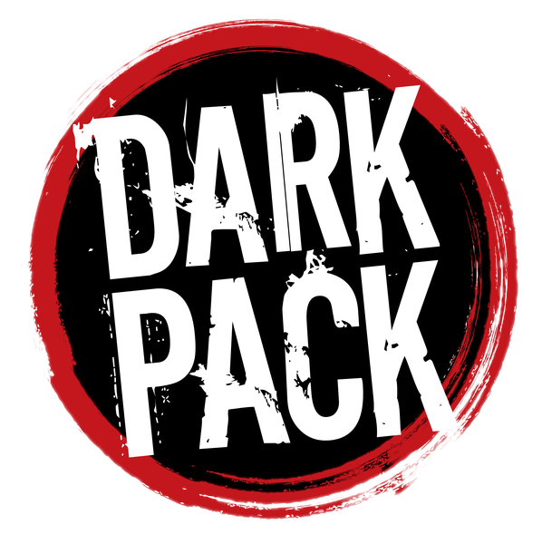

# World of Darkness 20th Edition (WoD20) para LoomVTT

Sistema de regras oficial para LoomVTT compatível com a linha de 20º Aniversário do Mundo das Trevas (Storyteller System).

## Funcionalidades e Mecânicas Implementadas

### 1. Motor de Rolagens Storyteller 20th
- **Parada de d10s** contra Dificuldade configurável (2 a 10).
- **Cancelamento por 1s** e detecção matemática precisa de **Sucessos**, **Falha Simples** e **Falha Crítica (Botch)**.
- **Especializações** (10s contam dobro).
- **Gasto de Força de Vontade** (+1 Sucesso garantido que não é cancelado por 1s).
- Diálogo modal ágil e card temático no chat do LoomVTT.

### 2. Arquitetura Modular de Fichas (Zero Redundância & Alta Performance)
- **Partials Pré-compilados:** O sistema pré-carrega todos os templates na memória (`loadTemplates`), reaproveitando Atributos, Habilidades, Vitalidade, Combate e Biografia/XP em todas as fichas.
- **5 Abas Completas:**
  1. *Atributos & Habilidades:* 9 Atributos, 30 Habilidades com campos de especialização (4+) e combos de rolagem em 1 clique.
  2. *Vantagens & Recursos:* Adaptada dinamicamente conforme o tipo do personagem.
  3. *Aba Especial:* **Formas Garou** para Lobisomem ou **Esferas & Mágika** para Mago.
  4. *Vitalidade & Combate:* 7 níveis de dano com penalidades, Iniciativa, Soak e tabelas de Armas/Armaduras.
  5. *Biografia & Experiência:* Prelúdio/Histórico, Descrição visual, Contatos e rastreador de XP Total e Não-Gasto.

### 3. Mecânicas Especializadas por Criatura
- **Lobisomem (W20):**
  - **As 5 Formas Garou:** *Hominídeo, Glabro, Crinos, Hispo e Lupino* com modificadores de atributos em tempo real, dano agravado em Crinos/Hispo, regeneração rápida e Delírio.
  - **Tríade Garou:** Fúria (com teste de Frenesi), Gnose (com teste de travessia para a Umbra) e Renome (Glória, Honra, Sabedoria).
- **Mago (M20):**
  - **As 9 Esferas:** Correspondência, Entropia, Forças, Matéria, Mente, Primórdio, Vida, Tempo e Espírito.
  - **Arete & Calculadora de Mágika:** Cálculo automático de dificuldade (Coincidente vs Vulgar com/sem testemunhas) e canalização de Quintessência.
  - **Roda de Quintessência e Paradoxo (20 pontos)** com teste de Choque de Retorno (*Backlash*).
- **Vampiro (V20):**
  - **Tabela de Geração Automatizada:** Geração calcula limite máximo de Sangue (10 a 50) e gasto por turno (1 a 10).
  - Ação rápida de **Cura com Sangue** (cura 1 nível de dano de contusão ou letal).
  - Virtudes (Consciência/Convicção, Autocontrole/Instinto, Coragem) e Humanidade/Trilha.
- **Mortal & Caçador (Hunter):**
  - Ficha limpa sem poluição de recursos sobrenaturais, com caixas de Convicção para Caçadores.

### 4. Ficha Universal de Itens (`WoDItemSheet`)
- Suporte dedicado a **todos os 24 tipos de itens do WoD 20th**:
  - *Lobisomem:* Fetiches (`fetish`), Talis (`talen`), Ritos (`rite`), Totem (`totem`), Dons (`gift`).
  - *Mago:* Rotes (`rote`), Maravilhas (`wonder`), Grimórios (`grimoire`), Talismãs (`talisman`), Artefatos (`artifact`).
  - *Vampiro:* Disciplinas (`discipline`), Rituais (`ritual`), Trilhas (`path`).
  - *Gerais:* Armas (`weapon`), Armaduras (`armor`), Antecedentes (`background`), Qualidades e Defeitos (`merit`, `flaw`).

### 5. Multi-Idioma (i18n)
- 100% dos termos, atributos, habilidades, itens e diálogos suportam **Português (Brasil)** e **Inglês**.

## Aviso legal

Portions of the materials are the copyrights and trademarks of Paradox Interactive AB, and are used with permission. All rights reserved. For more information please visit worldofdarkness.com.

Este material não é oficial de World of Darkness. Ele é um projeto de fã, gratuito e não comercial.

